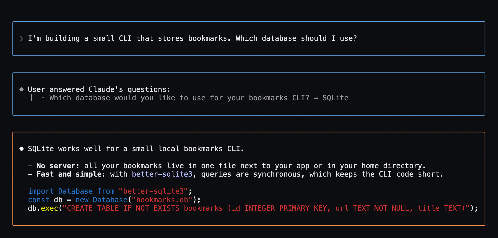
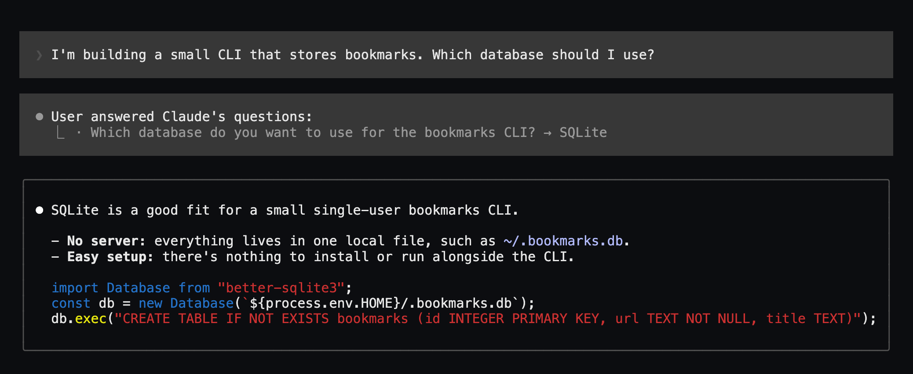
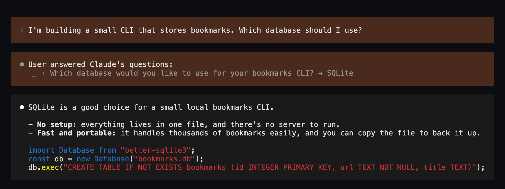
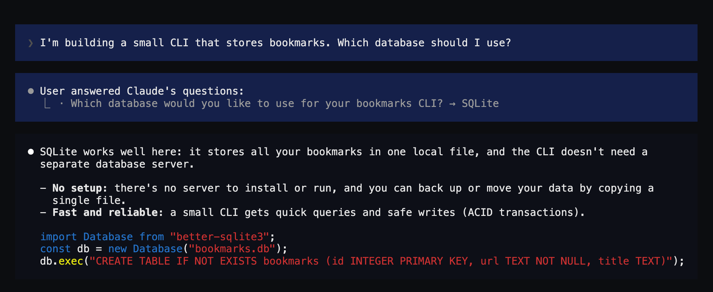

# boxed-ui

A Claude Code mod that sets your prompts and Claude's replies apart in padded, themeable boxes. Your answers in Claude's question dialog ("User answered Claude's questions") get the prompt box too.



Inspired by [yugal1107/ui-themes](https://github.com/yugal1107/ui-themes), built differently on purpose:

- **Claude Code still renders the replies.** The mod only puts a box around the engine's own drawing (`next(e)`), so markdown, nested lists, code blocks, tables and links look exactly as without it. No second markdown parser.
- **Light and dark.** Every theme has a `dark` and a `light` variant. `native` uses Claude Code theme keys (`userMessageBackground`, `subtle`) and follows any theme by itself.
- **The status line is left alone.** Keep whatever `statusLine` you have.
- **Terminal only.** Desktop, VS Code and mobile keep their own look.

## Install

In a Claude Code session:

```
/plugin install boxed-ui --marketplace perelin/boxed-ui
```

Answer `y` to add the marketplace, then pick a scope (user scope for every project). New sessions load the mod; `/plugin` turns it off or on.

To update: `/plugin marketplace update boxed-ui`, `/plugin update boxed-ui@boxed-ui`, then `/reload-plugins` in a running session.

## Use

| Command | What it does |
|---|---|
| `/boxed-ui` | Pick a theme from a list (↑/↓, Enter, Esc) |
| `/boxed-ui <name>` | Switch to a theme; `off` turns the boxes off |
| `/boxed-ui next` | Cycle to the next theme |
| `/boxed-ui list` | Show the active theme, the variant in use and all themes |
| `/boxed-ui light` / `dark` | Pin the variant |
| `/boxed-ui auto` | Take the variant from the Claude Code theme again |

The choice is kept across sessions.

### Light, dark and `auto`

With `/theme` set to a light or dark theme, the matching variant is used. Claude Code's `auto` follows the terminal background, which a mod cannot read, so under `auto` the dark variant is used. On a light terminal, run `/boxed-ui light` once.

## Themes

| Theme | Look |
|---|---|
| `native` (default) | Prompt in Claude Code's own message background, replies in a subtle rounded frame |
| `outline` | No fill: prompts in a blue frame, replies in an orange one |
| `claude-warm` | Terracotta prompts, charcoal replies; light: sand and paper |
| `night-blue` | Navy prompts, near-black replies; light: ice and mist |

The dark variants, each from a real session:

| `native` | `outline` |
|---|---|
|  |  |
| **`claude-warm`** | **`night-blue`** |
|  |  |

### Your own

Put a JSON file in `~/.claude/boxed-ui/themes/<name>.json`. A file with the name of a shipped theme replaces it.

```json
{
  "description": "One line for the picker",
  "dark":  { "prompt": { "bg": "#4a2a1c" }, "reply": { "bg": "#1a1a1a" } },
  "light": { "prompt": { "bg": "#f3dccf" }, "reply": { "border": "subtle" } }
}
```

Each box takes `bg` (background) and/or `border` (rounded frame). A value is a hex colour or a Claude Code theme key such as `userMessageBackground`, `subtle`, `claude` or `promptBorder`; theme keys follow your `/theme`. A theme with only one variant uses it for both.

## Known limits

- Your prompt is drawn by the mod as plain text, because the engine paints its own background under the text it draws, which would show as a second colour inside the box. Inline markdown in prompts (`**bold**`) is therefore shown as typed.
- While a reply streams, Claude Code draws it unboxed; it moves into the box once the block is done.
- Built on Claude Code's function-hook plugin API, which is in early access and may change between releases.

## Development

Run the mod straight from a checkout; edits reload when a turn ends:

```
claude --plugin-dir path/to/boxed-ui
```

```
claude plugin validate .
claude plugin test .
```

`scripts/screenshots/make.sh [theme ...]` records a short real session per theme in tmux and renders it to `docs/screenshots/`. It needs tmux, Python 3, Google Chrome (`CHROME=` for another path) and a logged-in `claude`; each theme costs one short model turn.

## License

[MIT](LICENSE)
